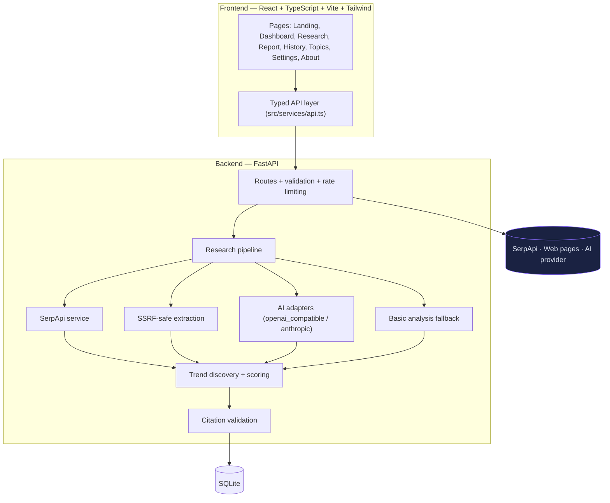

# TrendMind AI — The Web Intelligence Engine

**Search the web. Discover patterns. Understand what matters.**

TrendMind AI is an AI-powered web research and trend intelligence platform.
Enter a topic, question, technology, industry, or emerging trend — the platform
retrieves web search results, organizes evidence, identifies recurring themes,
compares source claims, and presents a structured intelligence report with
validated citations.

---

When evidence is insufficient, reports say so explicitly.

## Implementation checklist

All phases completed and verified (details in the final response):

- [x] **Phase 1 — Foundation:** structure, dependencies, design system, landing page + dashboard shell, frontend builds
- [x] **Phase 2 — UI:** navigation + mobile drawer, search form with filters, result/theme cards, loading/error/empty states, labeled demo data, responsive layouts, 4 component tests
- [x] **Phase 3 — Backend:** FastAPI, env config, SQLite persistence, validated routes, health/config endpoints, tests run (**126 passed**)
- [x] **Phase 4 — SerpApi:** search service, tolerant normalization, full error handling (missing key/timeout/rate limit/empty/API errors), mocked tests, demo mode
- [x] **Phase 5 — Analysis:** openai_compatible + anthropic adapters, bounded evidence package, strict schema, citation verification with exactly one repair attempt, basic-mode fallback, malformed-output tests
- [x] **Phase 6 — Trends:** theme discovery, documented scoring formula, evidence coverage, Recharts on real data, snapshot labeling
- [x] **Phase 7 — History & reports:** history with pagination/deletion, saved topics, 12-section report page, Markdown/JSON export, persistence verified
- [x] **Phase 8 — Security & QA:** validation/error handling, SSRF test suite, secret-handling review, backend **126 passed**, frontend tsc + eslint + vitest **4/4** + build all pass
- [x] **Phase 9 — Docs & deployment:** README, methodology/architecture/deployment docs, Vercel config, local-run checklist, honest limitations

## Problem statement

Web research today is fragmented: results are scattered across tabs, snippets
lack context, sources contradict each other without resolution, and AI tools
frequently invent statistics or citations. Analysts, students, and engineers
need a way to move from a raw query to a *structured, evidence-linked* report —
one that is honest about what is known, what is interpreted, and what remains
unverified.

## Proposed solution

TrendMind AI runs a transparent research pipeline:

1. **Collect** normalized search results (SerpApi) — or clearly labeled demo
   data when no key is configured.
2. **Extract** readable content from publicly accessible pages through an
   SSRF-protected fetcher — falling back to snippets when pages are blocked.
3. **Analyze** a bounded evidence package with a configurable AI provider — or
   a deterministic, clearly labeled basic mode when no AI is configured.
4. **Validate** every citation against the sources actually collected, then
   **store** and render the report with charts computed from real data.

---

## Main features

- **Landing page** with hero research input, example topics, capabilities,
  product preview, methodology, and footer links.
- **Intelligence dashboard** — recent research, saved topics, real activity
  counts (computed from this instance's database, never invented).
- **Research workspace** — validated query + filters (category, region,
  language, time range, result count), loading/error/empty states.
- **SerpApi live search** from the backend only; key never reaches the browser.
- **Demo mode** with mock data on reserved `example.com` domains, `[DEMO]`
  titles, and an amber badge — never mistaken for live information.
- **SSRF-protected source extraction** (DNS checks, redirect re-validation,
  timeouts, size caps, robots.txt, HTML-only, no JS execution).
- **AI analysis** with strict structured output, prompt-injection defenses,
  and **exactly one** repair attempt before falling back.
- **Deterministic basic analysis** fallback — labeled as non-AI everywhere.
- **Trend discovery** — themes, recurring terms, conflicts, and gaps with a
  documented 0–100 evidence-strength formula.
- **Intelligence reports** — 12 sections from research question to methodology,
  with clickable citations that can only point at collected sources.
- **Interactive analytics** — theme distribution, source distribution, evidence
  coverage (Recharts; real data only; accessible descriptions; empty states).
- **Research history** with pagination and deletion; **saved topics** with
  add/remove.
- **Report export** — Markdown and JSON with safe filenames and escaped content.
- **Settings** — search defaults, theme preference, configuration status
  (booleans only, no secrets), privacy explanation.
- **Accessible UI** — semantic HTML, visible focus states, keyboard navigation,
  Escape-closing dialogs/drawers, `prefers-reduced-motion` support, responsive
  from mobile to desktop.

---

## Architecture overview



Detailed diagrams: [`docs/architecture.md`](docs/architecture.md).

## Technology stack

| Layer | Technology |
|---|---|
| Frontend | React 18, TypeScript, Vite 6, Tailwind CSS 3, React Router 6, Recharts, Lucide icons |
| Frontend QA | tsc, ESLint (flat config), Vitest + Testing Library |
| Backend | Python 3.13, FastAPI, Pydantic 2, httpx, uvicorn |
| Persistence | SQLite (parameterized queries, idempotent schema) |
| Search | SerpApi Search API (backend-only) |
| AI | OpenAI-compatible chat completions + Anthropic Messages (optional) |
| Testing | pytest, pytest-asyncio, httpx MockTransport (no live credits) |

## Project structure

```
TrendMind-AI/
├── README.md
├── .gitignore                  # .env, secrets, build output ignored
├── .env.example                # placeholders only
├── docs/
│   ├── architecture.md
│   ├── methodology.md
│   └── deployment.md
├── frontend/
│   ├── package.json / vite.config.ts / tsconfig*.json
│   ├── tailwind.config.js      # design tokens
│   ├── eslint.config.js
│   ├── vercel.json             # SPA rewrite
│   ├── .env.example            # VITE_ vars (no secrets, ever)
│   └── src/
│       ├── main.tsx / App.tsx
│       ├── components/  (layout, ui, search, results, report, charts)
│       ├── pages/       (Landing, Dashboard, NewResearch, ReportPage,
│       │                 History, SavedTopics, Settings, About)
│       ├── hooks/       (useToast, useConfigStatus)
│       ├── services/    (api.ts — the only fetch layer)
│       ├── types/       (api.ts — mirrors backend schemas)
│       ├── styles/      (index.css — design system)
│       └── test/        (Vitest component tests, mocked API)
└── backend/
    ├── requirements.txt
    ├── app/
    │   ├── main.py             # app factory, CORS, error handlers, logging
    │   ├── config.py           # env-based settings (no secrets logged)
    │   ├── api/routes.py       # all endpoints
    │   ├── schemas/            # Pydantic contract
    │   ├── services/
    │   │   ├── search_service.py      # SerpApi
    │   │   ├── demo_data.py           # labeled mock results
    │   │   ├── extraction_service.py  # SSRF-protected fetch
    │   │   ├── html_to_text.py        # stdlib HTML → text
    │   │   ├── analysis_pipeline.py   # orchestration
    │   │   ├── basic_analysis.py      # deterministic fallback
    │   │   ├── trends.py              # themes + scoring formula
    │   │   ├── citations.py           # citation validation
    │   │   ├── export.py              # Markdown / JSON
    │   │   └── ai/                    # adapters + prompts
    │   ├── database/           # db.py, repository.py
    │   └── security/           # ssrf.py, ratelimit.py, sanitize.py
    └── tests/                  # 126 tests, all externals mocked
```

---

## Prerequisites

- **Node.js 20+** and npm (verified on Node 24)
- **Python 3.11+** and pip (verified on 3.13)
- Optional: SerpApi key (live search), AI provider key (LLM analysis)

## Local installation

### 1. Backend

```bash
cd backend
pip install -r requirements.txt
```

### 2. Frontend

```bash
cd frontend
npm install
```

### 3. Environment

```bash
cp .env.example .env          # backend secrets (git-ignored)
cp frontend/.env.example frontend/.env.local   # VITE_ vars (no secrets)
```

## Frontend setup

```bash
cd frontend
npm run dev          # http://localhost:5173
```

Scripts: `npm run dev` · `npm run build` · `npm run typecheck` ·
`npm run lint` · `npm test`.

## Backend setup

```bash
cd backend
uvicorn app.main:app --reload --port 8000
```

- API docs: `http://localhost:8000/api/docs`
- Health: `GET /api/health`
- Config status: `GET /api/config/status`

---

## Environment variables

### Backend (`.env` at repo root — **never commit**)

| Variable | Default | Purpose |
|---|---|---|
| `HOST` / `PORT` | `0.0.0.0` / `8000` | Server bind |
| `CORS_ORIGINS` | `http://localhost:5173,…` | Comma-separated allowed origins |
| `DATABASE_PATH` | `./data/trendmind.db` | SQLite file location |
| `SERPAPI_API_KEY` | *(empty)* | **Live search.** Empty ⇒ Demo Mode |
| `SERPAPI_ENGINE` | `google` | SerpApi engine |
| `SEARCH_TIMEOUT_SECONDS` | `10` | Search request timeout |
| `MAX_RESULTS_LIMIT` | `20` | Server-side result cap |
| `MAX_QUERY_LENGTH` | `300` | Query character cap |
| `ENABLE_SOURCE_EXTRACTION` | `true` | Page fetching (SSRF-protected) |
| `MAX_EXTRACT_PAGES` | `3` | Pages fetched per run |
| `EXTRACT_TIMEOUT_SECONDS` | `8` | Per-page timeout |
| `MAX_PAGE_BYTES` | `1500000` | Response size cap |
| `MAX_EXTRACT_CHARS` | `12000` | Extracted text cap per page |
| `AI_PROVIDER` | `none` | `none` \| `openai_compatible` \| `anthropic` |
| `AI_MODEL` | *(empty)* | Model name (required for AI mode) |
| `AI_API_KEY` | *(empty)* | Provider key (never exposed) |
| `AI_BASE_URL` | OpenAI v1 | Any OpenAI-compatible endpoint |
| `AI_TIMEOUT_SECONDS` | `45` | AI request timeout |
| `AI_MAX_EVIDENCE_CHARS` | `24000` | Evidence package cap |
| `RESEARCH_RATE_LIMIT_PER_MINUTE` | `6` | Per-client limit on `POST /api/research` |
| `GITHUB_REPO_URL` | *(empty)* | Footer/About repository link |

### Frontend (`frontend/.env.local` — **no secrets, ever**)

| Variable | Purpose |
|---|---|
| `VITE_API_BASE_URL` | Backend base URL (e.g. `http://localhost:8000`) |
| `VITE_APP_VERSION` | Displayed application version |
| `VITE_GITHUB_REPO_URL` | Optional footer/About link |

> Anything prefixed `VITE_` is embedded in the browser bundle. Server secrets
> (SerpApi, AI keys) **must never** be placed there.

## SerpApi setup

1. Create a key at [serpapi.com](https://serpapi.com) (free tier available).
2. Add `SERPAPI_API_KEY=your_key` to `.env`.
3. Restart the backend. `/api/config/status` now reports
   `"serpapiConfigured": true` and `"searchMode": "live"`.
4. Leave it empty to stay in **Demo Mode** (no credits consumed).

## AI provider setup

**OpenAI-compatible** (OpenAI, OpenRouter, Groq, local gateways):

```bash
AI_PROVIDER=openai_compatible
AI_MODEL=gpt-4o-mini
AI_API_KEY=sk-...
AI_BASE_URL=https://api.openai.com/v1
```

**Anthropic:**

```bash
AI_PROVIDER=anthropic
AI_MODEL=claude-sonnet-4-5
AI_API_KEY=sk-ant-...
```

**No AI (default):** `AI_PROVIDER=none` — reports are produced by the
deterministic basic analysis and labeled **Basic analysis** in the UI. The app
remains fully functional.

## Demo mode

Demo mode activates automatically when `SERPAPI_API_KEY` is unset (or can be
forced by leaving it empty). Characteristics:

- Results use reserved `example.com/.org/.net` domains with `[DEMO]` titles.
- The API stamps `mode: "demo"`; the UI shows an amber **Demo data** badge.
- The full pipeline (themes, charts, report, export) runs on mock data —
  ideal for development and demos without consuming credits.

---

## Running tests

### Backend (externals mocked — no live API calls)

```bash
cd backend
python -m pytest tests/ -q
```

**Result: 126 passed** covering: health/config endpoints, input validation,
missing SerpApi key, search normalization (valid/malformed/empty), API error
mapping (timeout, 429, auth, unreadable), citation validation, trend analysis
and scoring, database persistence, report generation/export, SSRF URL
validation, source-extraction restrictions, HTML extraction, AI malformed-output
handling (one repair attempt then fallback), prompt-injection containment, and
rate limiting.

### Frontend

```bash
cd frontend
npm run typecheck     # tsc — passed
npm run lint          # eslint — passed
npm test              # vitest — 4 passed (API mocked)
npm run build         # production build — passed
```

---

## API reference

| Method | Endpoint | Purpose |
|---|---|---|
| GET | `/api/health` | Liveness + version |
| GET | `/api/config/status` | Feature flags (booleans only, no secrets) |
| POST | `/api/research` | Run a research query (rate-limited) |
| GET | `/api/research?limit&offset` | History list with pagination |
| GET | `/api/research/{id}` | Full record + report |
| DELETE | `/api/research/{id}` | Delete a record |
| GET | `/api/topics` | Saved topics |
| POST | `/api/topics` | Save a topic |
| DELETE | `/api/topics/{id}` | Remove a topic |
| GET | `/api/reports/{id}/markdown` | Markdown export (attachment) |
| GET | `/api/reports/{id}/json` | JSON export (attachment) |

Errors always return:
`{"error": {"code": "...", "message": "user-facing text", "details": {...}}}`

---

## Troubleshooting

| Symptom | Cause & fix |
|---|---|
| "Live search is not configured yet…" | Set `SERPAPI_API_KEY` in `.env` and restart, or stay in Demo Mode. |
| Frontend "Could not reach the TrendMind backend" | Backend not running or wrong `VITE_API_BASE_URL`. Start uvicorn; check `/api/health`. |
| CORS error in browser console | `CORS_ORIGINS` must include your exact frontend origin (no trailing slash). |
| "Search capacity has temporarily been reached" | SerpApi quota/rate limit or the app's own limit. Wait, or raise `RESEARCH_RATE_LIMIT_PER_MINUTE`. |
| Report says "Basic analysis" though AI key set | `AI_MODEL` missing, or `AI_PROVIDER` unrecognized. Check `/api/config/status` → `aiConfigured`. |
| Empty results | Query too narrow. Broaden it or change filters — the app reports this explicitly. |
| "This source could not be accessed…" | Page blocked/timeout; the report correctly uses the search snippet and says so. |
| Tables empty after redeploy | SQLite on ephemeral storage — use a persistent `DATABASE_PATH` (see deployment docs). |
| `npm run build` fails on type check | Run `npm run typecheck` to see errors; ensure `npm install` completed. |

## Deployment

See [`docs/deployment.md`](docs/deployment.md) for Vercel (frontend) + a Python
host (backend), including SPA rewrites, environment configuration, SQLite
persistence, and a post-deploy verification checklist.

**Deployment is not claimed to be live** — no deployment has been performed
from this environment. Follow the checklist in the doc to deploy and verify.

## Security notes

- **Secrets:** environment-only; `.env` is git-ignored; `.env.example` has
  placeholders; logs redact `api_key/token/secret/password` patterns; errors
  never include stack traces or credentials.
- **SSRF:** http(s)-only, credential-URL rejection, localhost/internal-suffix
  blocking, DNS resolution with private/loopback/link-local/CGNAT/IPv6-internal
  checks, per-hop redirect re-validation (max 3), port allow-list, byte caps,
  timeouts, HTML content types only, **no JavaScript execution**, robots.txt
  respected, no paywall/auth bypass.
- **Prompt injection:** retrieved content is delimited and declared untrusted;
  instructions inside it are ignored; no tools/code execution exist in the
  analysis step; AI-generated URLs are never fetched without full SSRF checks.
- **Input validation:** Pydantic schemas with allow-listed filter values,
  length caps, and a 64 KB request-size limit.
- **Rate limiting:** sliding-window limiter on `POST /api/research`.
- **CORS:** explicit origin allow-list (never `*` by default), no credentials.
- **Output escaping:** Markdown exports escape HTML/`|`; the frontend renders
  text as text (no `dangerouslySetInnerHTML` anywhere).
- **Dependency hygiene:** small, stable dependency set (no scraping frameworks,
  no headless browsers).

## Limitations

- **No authentication.** History and saved topics are shared across the
  instance and are **not private per user**.
- **Snapshot analysis.** One search cannot establish trends over time; findings
  are phrased as themes observed in the collected results.
- **Demo domains.** Demo links point to reserved `example.*` pages by design.
- **AI-dependent sections.** Opportunities/developments are sparse in basic
  mode (deliberately — it does not fabricate interpretation).
- **Rate limiter is per-process/in-memory** — multi-worker deployments multiply
  the effective limit.
- **Some sites block extraction** (JS-rendered, bot-protected, paywalled);
  these degrade to snippet analysis and are labeled as such.
- **PDF export not implemented** — Markdown and JSON only (reliable, no extra
  dependencies).
- **No historical snapshots** — the timeline chart renders only when valid
  publication dates exist in collected data.

## Future improvements

- Authentication with server-side authorization on every private record.
- Scheduled snapshot collection for genuine time-series trend charts.
- User-managed extraction allow/deny lists and per-domain concurrency limits.
- PDF export via an optional, well-tested renderer.
- External database adapter (Postgres) behind the repository layer.
- Streaming/partial results for long research runs.
- Light theme and richer keyboard shortcuts.

## Recording a demo

1. `cp .env.example .env` — leave `SERPAPI_API_KEY` empty (Demo Mode) or add a
   real key for live search.
2. Start backend: `cd backend && uvicorn app.main:app --reload --port 8000`.
3. Start frontend: `cd frontend && npm run dev`.
4. Open `http://localhost:5173` and record:
   - Landing page → hero input → example topic chip → research runs.
   - Demo badge visible; results cards with links; **Open full report**.
   - Report sections, citations, theme cards, three charts.
   - Export Markdown / JSON.
   - History pagination + delete; saved topics add/remove; Settings status.
   - Mobile layout via dev-tools responsive mode (drawer navigation).
5. Optional: show `npm test` and `python -m pytest tests/ -q` output to
   demonstrate mocked, credit-free tests.

---

## License

All rights reserved © 2026 TrendMind AI.
