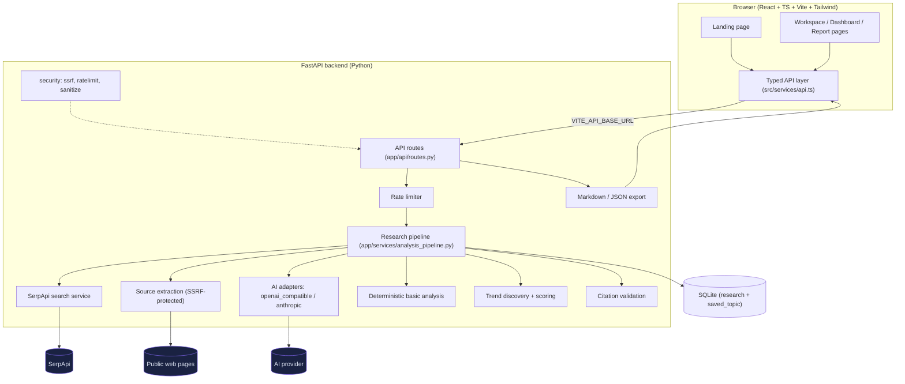
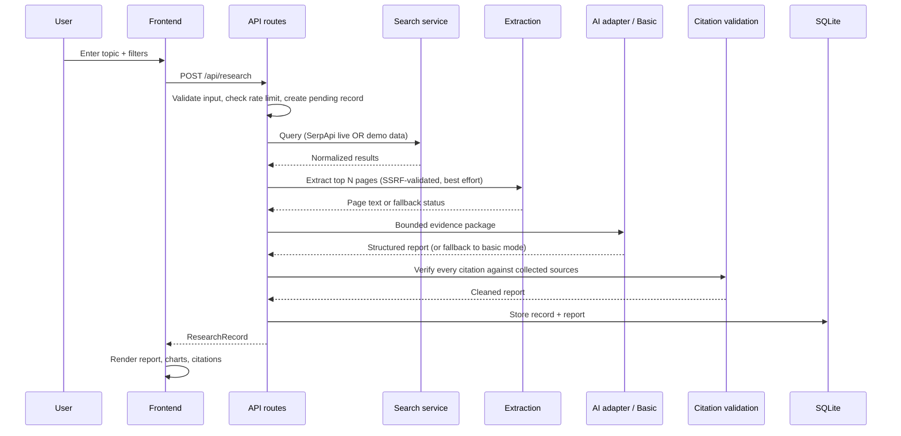
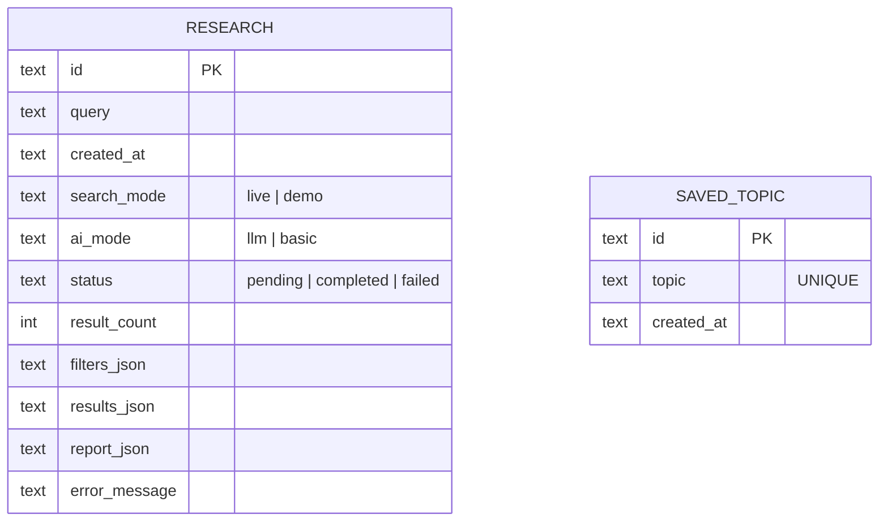

# Architecture — TrendMind AI

## Overview

TrendMind AI is a two-service application: a React SPA frontend and a FastAPI
backend that owns all secrets, external calls, analysis, and persistence.



## Research pipeline sequence



## Layers

| Layer | Location | Responsibility |
|---|---|---|
| UI | `frontend/src/pages`, `components` | Presentation only; no direct `fetch` |
| API client | `frontend/src/services/api.ts` | Typed HTTP, timeouts, error mapping |
| Types | `frontend/src/types/api.ts` | Mirrors backend Pydantic schemas |
| Routes | `backend/app/api/routes.py` | Validation, rate limiting, error envelope |
| Pipeline | `backend/app/services/analysis_pipeline.py` | Orchestrates search → extraction → analysis → validation |
| Search | `backend/app/services/search_service.py` | SerpApi integration + normalization |
| Extraction | `backend/app/services/extraction_service.py` | SSRF-safe fetching + HTML → text |
| AI | `backend/app/services/ai/` | Provider adapters + prompts |
| Analysis | `basic_analysis.py`, `trends.py`, `citations.py` | Fallback mode, themes/scoring, citation checks |
| Persistence | `backend/app/database/` | SQLite, parameterized queries, repositories |
| Security | `backend/app/security/` | SSRF validation, rate limiting, secret redaction |

## Key design decisions

1. **Search and analysis are separate services.** The AI step never performs
   searches; it only consumes the bounded evidence package. This keeps external
   calls predictable, testable, and cheap.
2. **Fail open to evidence, closed to fabrication.** If AI analysis fails, the
   run falls back to deterministic basic mode with search results preserved. If
   search fails, the run fails with a clear message — nothing is invented.
3. **One repair attempt, then fallback.** Structured output is validated;
   at most one repair call is made. No retry loops against paid APIs.
4. **Citations are data, not text.** Source IDs are validated against collected
   sources before storage; the frontend can only link to what exists.
5. **Secrets stay server-side.** The frontend reads only boolean configuration
   flags from `/api/config/status`; no `VITE_` variable ever holds a secret.
6. **Demo mode is structurally visible.** Mock data uses reserved domains,
   `[DEMO]` titles, and a distinct badge — it cannot be mistaken for live data.

## Data model (SQLite)



Schema is created idempotently at startup (`CREATE TABLE IF NOT EXISTS`) —
documented initialization strategy with no external migration tool required.

## Error contract

All error responses share one shape:

```json
{ "error": { "code": "rate_limited", "message": "…user-facing…", "details": {} } }
```

Codes are stable strings (`validation_error`, `search_not_configured`,
`rate_limited`, `not_found`, `payload_too_large`, `internal_error`, …).
Stack traces and secrets never reach the client; full tracebacks go to
server-side logs only.

## Trust boundaries

- **Untrusted:** search results, webpage content, AI output, user queries.
  All are validated/sanitized before use.
- **Trusted:** environment configuration, application code, database contents
  written by the backend itself.
- **No code execution:** neither model output nor scraped content is ever
  executed; extraction uses a parser, not a browser.
